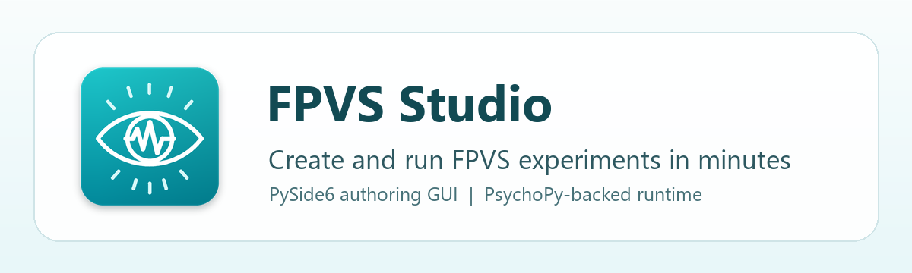

# FPVS Studio



FPVS Studio helps researchers prepare stimuli, create image and word Fast Periodic
Visual Stimulation experiments, and run repeated participant sessions without writing
experiment code. Guided Setup covers conditions, stimuli, timing, display/session
settings and optional fixation and response tasks. Saved projects retain those choices
for subsequent participants.

Researchers can use externally prepared images or optionally create separate copies
with Image Resizer and Image Equalizer. Image Equalizer automatically matches grayscale
brightness and RMS contrast across multiple input/output folder pairs. Monitor
calibration remains external to these image tools.

Studio supports Windows acquisition and experimental macOS source playback. See the
[current product specification](docs/product-specs/studio.md) for its mission and scope,
and the [recording contract](docs/RUNTIME_EXECUTION.md#trigger-behavior) for recording
options and qualification boundaries.


## Installation Instructions

For experimental **macOS source-only authoring and local tests**, see the
[Mac source guide](docs/MACOS_SUPPORT.md). EEG acquisition remains on Windows.

Public user documentation is available at
https://zcm58.github.io/FPVS-Studio-2.0/.

Download the Windows installer from the
[latest FPVS Studio release](https://github.com/zcm58/FPVS-Studio-2.0/releases/latest).

Run the installer, then launch FPVS Studio from the Start Menu or Desktop shortcut.
You do not need to install Python or open the source code.

On first launch, FPVS Studio asks you to choose an **FPVS Studio Root Folder**. This
folder is where all of your future FPVS experiments will be stored. 

Sometimes, using OneDrive or other services that sync with a cloud service can cause 
issues with loading and running your experiments, so I recommend placing your root folder
outside of one of those directories.

### Windows source setup

Clone or extract the entire repository. Close PyCharm if it is open, then
double-click **Setup Windows.cmd**. Setup prepares 64-bit Python 3.11, installs
`requirements.txt`, and leaves the virtual environment active in its PowerShell window.

Run `fpvs-studio` in that window, or open the checkout in PyCharm and select
**FPVS Studio (Windows)** to run `src/fpvs_studio/app/main.py`. See the
[Windows setup guide](docs/ENVIRONMENT.md#windows-source-setup) for details.

### Mac source setup

Download or clone the **entire repository**, then open its folder in Finder:

1. Double-click **Setup Mac.command**. It prepares native Python 3.11, the virtual
   environment and all Mac GUI/engine requirements, then checks the installation.
2. Double-click **Run Mac.command** to open Studio. Python and PyCharm do not need
   to be installed beforehand.

For an existing installation that needs repair, pull the complete source update,
then double-click **Repair Mac 2.command**. It repairs the environment, checks the
engine and automatically sends a concise completion report to Studio support.
The final window states both the repair outcome and whether the report was submitted.
3. Optional: fully quit PyCharm, then use **Open in PyCharm Mac.command** and select
   **FPVS Studio (Mac)** in its Run menu. The interpreter and `main.py` path are prepared.

An Intel Mac may need Apple's Command Line Tools installer and administrator prompts
for Homebrew build tools. Follow the setup window; rerun Setup after Apple's installer
finishes. See the [Mac setup guide](docs/MACOS_SUPPORT.md#install-run-and-update-from-source)
for first-run details, logs and recovery. Mac support remains experimental and excludes EEG.


## Create Your First Project

1. Open FPVS Studio.
2. Choose `Create Project`.
3. Enter a project name.
4. Follow the Setup Wizard instructions :) 

The Setup Wizard walks through:

- `Project`: project name, description, experiment category, and participant settings.
- `Conditions`: condition names, trigger codes, instructions, and selecting your base and oddball images.
- `Experiment`: display refresh rate, background color, and how many times you'd like your conditions to repeat.
- `Fixation`: fixation cross timing and target schedule.
- `Response`: optional fixation cross accuracy tracking task. 
- `Review`: Double check things before saving! 

## Prepare Images

FPVS Studio assumes that you've placed all of the images you'd like to display for each condition 
in their own folder. This makes setting up your projects easier. 

Each condition needs:

- a dedicated base image folder
- a dedicated oddball image folder
- All images must be the same square size and filetype (256x256, 512x512, etc. .png is the recommended file format)

FPVS Studio can optimize your images for FPVS using the built in image resizer tool. You can quickly resize all your images and change 
them to .png. 


## Run An Experiment

After setup is complete, return to Home and choose:

```text
Launch Experiment
```

Before playback starts, FPVS Studio checks the project and asks for a participant number.
Playback opens fullscreen and uses `Space` for start/continue prompts.

Run outputs are saved inside the project folder under:

```text
runs\
```

Project-level run history is stored under:

```text
logs\
```

## Reopen Existing Projects

Use:

```text
Open Project
```

After you've set up a project, FPVS Studio allows you to run those experiments in just a few clicks. 

## Manage Projects And Templates

Use the `File` menu to manage projects and change settings.


## Updating FPVS Studio

Use `Help > Check for Updates` inside FPVS Studio. You can download and install future updates from this screen.
